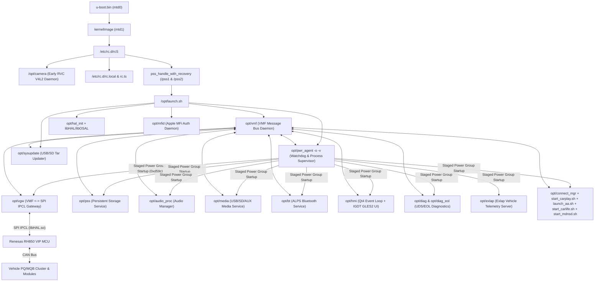

# RCD 330 Firmware & Hardware Architecture

Technical reference derived from direct Ghidra 12.2 decompilation of all 31 core ARMv7 ELF binaries and libraries plus the RH850 VIP firmware in `5624_vw` (`6RD 035 187 B/C/E/F`, Noname/Visteon) and `5606_skoda` firmware images ([docs/decompiled/README.md](decompiled/README.md)), cross-checked against community hardware analysis ([online-sources-summary.md](online-sources-summary.md)).

---

## 1. Hardware Platform Overview

| Subsystem | Component / Specification | Notes |
|---|---|---|
| **Application SoC (ApP)** | NXP / Freescale i.MX6 Solo / DualLite (`MCIMX6S6AVM08AC`, ARMv7-A Cortex-A9) | Visteon Eagle board (`MACH_TYPE 4400` / `0x1130`), runs Linux 3.0.35/3.0.38 (`5624`) or 3.1.15 (`5606`), `/dev/fb0` 800x480 |
| **GPU & Display** | Vivante GC880 / GC320 / GC355 (`libGAL`, `libEGL`, `libGLESv2`) + i.MX6 IPUv3 | Hardware 2D/3D acceleration for IGDT (`opt/hmi`), IPUv3 Channel 23 (`MEM_BG_SYNC`) scanout |
| **System RAM** | 512 MB DDR3 (187B/C/E/F) · 256 MB on early 187A | 512 MB required for CarPlay / Android Auto `5xxx` builds |
| **NAND Flash & MTD** | 256 MB Spansion (`ML02G100BHA00`), `mtd0`..`mtd5` | `mtd0` U-Boot, `mtd1` Kernel, `mtd2` UBIFS `/`, `mtd3` `/pss1`, `mtd4` `/pss2`, `mtd5` splash logo |
| **Vehicle MCU (VIP)** | Renesas RH850 (`R7F7010253`, QFP-100, 1 MB flash `vipImage.bin`) | CAN transceiver controller, PQ/MQB identity, power rail `EN` sequencing, hardware watchdog, AM/FM tuner DSP control |
| **VIP <-> SoC Link** | SPI IPCL (`/dev/spidev0.0`, `/dev/v850srq`, GPIO 83) | Driven by `opt/lib/libHAL.so.1.0.0` (`spi_ipcl_read` / `spi_ipcl_write`) and `opt/vgw` |
| **Touchscreen** | Atmel maXTouch T100 (`atmel_mxt_ts`, I2C4 `0x021f8000` / `/dev/i2c-3`, addr `0x4b`, GPIO1_27 IRQ) | Configured via `/lib/firmware/maxtouch.cfg`; read via `tslib` (`/dev/event1`, `/etc/pointercal`, `/etc/ts.conf`) |
| **Faceplate Buttons & Knobs** | `/dev/event0` (`EV_KEY` codes `1..10`) & `/dev/tuner_knob` (`0x32`/`0x33`) | Read by `VKeyDriver` ([`0xaa77c`](decompiled/5624/hmi/functions/0xaa77c.c)) & `VKnobDriver` ([`0xaa3e0`](decompiled/5624/hmi/functions/0xaa3e0.c)) in `opt/hmi` |
| **Reverse Camera (RVC)** | Analog Devices `ADV7182` (I2C4 `/dev/i2c-3`, addr `0x21`) | CVBS-to-digital V4L2 video decoder (`/dev/video0`, overlay `/dev/video17`), managed by `opt/camera` and `VCameraTask` |
| **Bluetooth Module** | ALPS (`BT_VER = C210`, UART) | Firmware stored in `bt_ac_firm/`, managed by `opt/bt` (`libcidb_sdk.so`) |

---

## 2. Flash & Filesystem Layout

On the target Linux system (`/etc/rc.d/rcS` & `/opt/launch.sh`):
- **`/` (`ubi0:rootfs` on `mtd2`)**: UBIFS root filesystem holding Linux system libraries (`/lib`, `/usr/lib`, `/usr/local/qte4.7.4`), certificates (`/etc`), MirrorLink kernel modules (`/mirrorlink`), and the `/opt` application tree. Remounted read-only (`mount -o remount,ro /`) by `rcS` prior to launching `/opt/launch.sh`.
- **`/opt`**: All infotainment binaries, shared libraries (`opt/lib/`), UI bitmap packs (`opt/gresfiles/`), TTF fonts (`opt/data/sysupdate_source/`), shell scripts, and Android Auto / CarPlay / CarLife / MirrorLink components.
- **`/pss1` & `/pss2` (`ubi1:pss1` on `mtd3`, `ubi2:pss2` on `mtd4`)**: Persistent Vehicle Settings Store (10 MB primary + 10 MB backup with automatic mutual recovery in `rcS` `pss_handle_with_recovery`) containing `stdplus.ini`, `hmi_autotest.ini`, `config/*.conf`, coding (`DIAG_PSS_CODING.pss`), feature flags (`FEATURE_MANAGER_PSS_BLK.pss`), BT state, safecode lock state, and `/pss2/app_data`.

---

## 3. True Boot Sequence & Runtime Process Supervision

Decompiling `opt/pwr_agent` ([`FUN_0000d59c`](decompiled/5624/services/pwr_agent/functions/0xd59c.c), `start_next_group_transition`) revealed why most services are commented out in `/opt/launch.sh`: **`opt/pwr_agent` is the runtime process supervisor** that spawns the remaining infotainment daemons in power-state groups after establishing the VIP handshake.

### Runtime Services (All 31 Decompiled Binaries & Libraries)
- **`opt/vmf`**, **`opt/lib/libvmf_client.so`**, **`opt/lib/libvmf_trace.so`**: Central publish/subscribe IPC message broker using System V shared memory and message queues. CLI helpers: **`opt/tools/vmf_send`** and **`opt/tools/vmf_rcv`**.
- **`opt/hal_init`**, **`opt/lib/libHAL.so.1.0.0`**, **`opt/lib/libOSAL.so.1.0.0`**: Hardware abstraction (SPI IPCL `/dev/spidev0.0`, `/dev/v850srq`, GPIO sysfs) and OS abstraction (threads, timers, logging, INI access).
- **`opt/vgw`**: Bridges VMF message groups `[0x8f, 0x8d, 0x7c]` and power channel `0x8e` to the Renesas RH850 VIP MCU over SPI IPCL. See [ipc-and-vgw.md](ipc-and-vgw.md).
- **`opt/pwr_agent`**: Manages power state transitions (`CL_S`, `CL_15`, standby/run/user-off, battery warnings), syncs version metadata in `/pss1/stdplus.ini`, supervises power-group service startup/shutdown ([`0xd59c`](decompiled/5624/services/pwr_agent/functions/0xd59c.c)), and feeds the periodic watchdog keepalive (`0x8f:0x03`) so VIP does not power-cycle the SoC after ~60 s.
- **`opt/hmi`**: 800x480 infotainment display and control logic application (`9,580` decompiled functions). See [hmi-internals.md](hmi-internals.md).
- **`opt/audio_proc`**: Audio Manager handling volume (`0..30`), mute, equalizer, fader/balance, and audio source switching with `VAudioProxy` (`0x3C..0x3F`, `0x45`, `0x47`).
- **`opt/media`**: Media indexing, browsing, and playback service for USB, SD, and AUX inputs (`0x28..0x2A`).
- **`opt/bt`**: Bluetooth stack daemon interfacing with the ALPS C210 UART module for HFP calls, phonebook sync, and A2DP streaming (`0x1E..0x20`, `0x22`, `0x26`, `0x27`).
- **`opt/camera`**: Early-boot V4L2 camera helper started by `/etc/rc.d/rcS` for instant Reverse Camera (`ADV7182`) display before userland completes startup.
- **`opt/pss`**: Persistent settings daemon reading/writing `.pss` blocks under `/pss1` and `/pss2` (`0x72`, `0x8C`).
- **`opt/diag`** & **`opt/diag_eol`**: Handle VW UDS and End-of-Line diagnostics, coding bytes, and fault memory reporting (`0x73`, `0xA0`, `0xA1`).
- **`opt/exlap`**: Exlap vehicle data server interfacing with VMF and `VBAPProxy`.
- **`opt/sysupdate`**: Validates and applies USB/SD `.tar` update packages (`0xBD`, `0xBE`). See [firmware-packaging-and-update.md](firmware-packaging-and-update.md).
- **`opt/screenshot`**: VMF listener capable of capturing `/dev/fb0` screenshots to PNG.
- **Smartphone Projection Stack**:
  - **`opt/connect_mgr`**: USB role switcher (`/proc/driver/usbroleswitch/0/mode`) and session coordinator (`0x8D`, `0xC8`, `0xC9`).
  - **Apple CarPlay**: **`opt/carplay_App`** (`0x81`, `0xC2`, `0xC3`), **`opt/carplayd`**, **`opt/iap2d`**, **`opt/mfid`**, **`opt/lib/libCarPlayAudio.so`**, **`opt/lib/libCarPlayPlatformSystem.so`** (launched by `opt/start_carplay.sh`).
  - **Android Auto**: **`opt/AndroidAuto/bin/AAP_Application`** (`0xDC`, `0xDD`) and `aap_service` (launched by `opt/launch_aa.sh`).
  - **Baidu CarLife**: **`opt/carlife_daemon`** (`0x83`, `0xC7`, launched by `opt/start_carlife.sh`).
  - **MirrorLink**: **`opt/lib/mirrorlink/libmlc_iface.so`** (`0xA4`, `0xC4`, `0xD2`, linked directly into `opt/hmi`).

---

## 4. Two-Part Project Architecture: QEMU Emulator & Alternative Headunit Software

This repository is organized around two primary components:

### Part 1: QEMU-Based Full-System Firmware Emulator (`qemu/` + `tools/`)
Boots and executes the **unmodified original retail ARMv7 firmware (`5624_vw`)** by emulating the Freescale i.MX6 Eagle board and its peripheral chips:
- **[qemu/hw/arm/rcd330.c](../qemu/hw/arm/rcd330.c)** (`-M rcd330`): Custom i.MX6 board (`MACH_TYPE 4400`, `digprog = 0x00610000`, 512 MB RAM) with Vivante GPU MMIO stubs (`0x00130000`, `0x00134000`, `0x02204000`), MXS APBH/GPMI reset block stub (`0x00112000`), `ADV7182` I2C stub (`0x20`/`0x21`), I2C4 controller (`0x021f8000`), uSDHC1 SD card slot, and 1x real-time i.MX6DL GPT `EN_24M`/`PRESCALER24M` + continuous Free-Run counter emulation ([qemu/hw/timer/imx_gpt.c](../qemu/hw/timer/imx_gpt.c)).
- **[qemu/hw/display/imx6_ipu.c](../qemu/hw/display/imx6_ipu.c)** (`imx6.ipu`): Emulates i.MX6 IPUv3 registers, 60 Hz VSYNC interrupts, and CPMEM Channel 23 (`MEM_BG_SYNC`) 800x480 framebuffer scanout (exposed over localhost VNC/RFB to the native Qt6 faceplate window, blanking immediately on reset).
- **[qemu/hw/input/atmel_mxt.c](../qemu/hw/input/atmel_mxt.c)** (`atmel.mxt`): Emulates the Atmel maXTouch T100 I2C touchscreen at `0x4b` on I2C4 (GPIO1_27 IRQ), translating mouse/pointer clicks and drags into T100 multi-touch reports for the kernel's `atmel_mxt_ts` driver and `tslib`.
- **[qemu/hw/misc/rcd330_vip.c](../qemu/hw/misc/rcd330_vip.c)** (`rcd330-vip`): Emulates the Renesas RH850 VIP MCU on eCSPI2 and fast MMIO `0x021fc000`, handling SPI IPCL handshakes, BAP startup/exit ACKs (`0x69`/`0x6b`), watchdog keepalives, CAN/BAP vehicle telemetry, physical faceplate button press/hold/release events (`/dev/event0` FIFO at `0x021fc020`), 10 s `POWER` hard-reboot timer with EEPROM persistence across resets, and volume/mute updates, controlled over a TCP chardev socket (`127.0.0.1:4444`).
- **ARM Guest Shims & Native Control Panel (`tools/`)**:
  - [tools/arm_gl/gl_fb_shim.c](../tools/arm_gl/gl_fb_shim.c): Guest `libEGL.so.1` / `libGLESv2.so.2` software renderer implementing the 11 `egl*`, 4 `fb*`, and 58 `gl*` calls used by IGDT in `opt/hmi` and scanning out to `/dev/fb0`.
  - [tools/arm_hal_shim/hal_gpio_shim.c](../tools/arm_hal_shim/hal_gpio_shim.c): Guest `LD_PRELOAD` bridge connecting `libHAL.so` GPIO/SPI IPCL, `/dev/v850srq`, and virtual `/dev/event0` to `rcd330-vip`.
  - [tools/rcd330_gui/](../tools/rcd330_gui/CMakeLists.txt): Unified cross-platform (macOS + Linux) native C++20 / Qt6 Widgets window (`build/gui/rcd330_gui`) embedding the live 800x480 touchscreen display over localhost RFB/VNC inside the VW RCD 330 faceplate bezel (with real press-and-hold + right-click quick-hold shortcuts, `POWER` 10 s hard reboot, volume/tune rotary knobs, CAN/BAP vehicle & tuner controls, VW Long Coding editor via [tools/rcd330_coding.py](../tools/rcd330_coding.py), and live VIP/IPCL console log).

### Part 2: Alternative Headunit Software (Planned)
Once full emulation of the original firmware and all hardware/IPC interfaces (`VMF`, `IPCL`, `HAL`, `BAP`, audio, media, Bluetooth, and projection protocols) is complete and verified against the QEMU hardware model, this project will also house an **alternative software stack for the RCD 330 headunit** (technology stack to be finalized).
