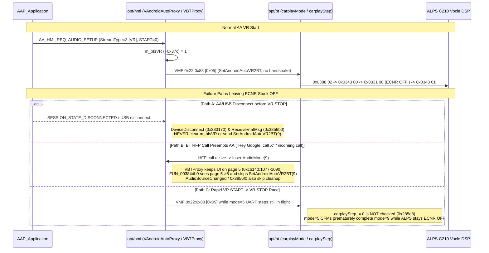

# Android Auto Bluetooth Call Echo Bug (ALPS ECNR State-Machine Defects)

Reverse-engineering root-cause analysis of the well-known RCD 330 **Android Auto phone-call echo bug**, where the remote party hears loud echo of their own voice during Bluetooth HFP calls after Android Auto Voice Recognition (Google Assistant) has been used.

- **Verified against**: `5624_vw` (full Ghidra 12.2 decompilation + ARM machine-code verification of `opt/hmi`, `opt/bt`, `opt/AndroidAuto/bin/AAP_Application`, `opt/audio_proc`, and `vipImage.bin`); same control paths confirmed present in `5606_skoda`.
- **Root cause summary**: **Android Auto VR (`mode=5`) is the only code path in the entire firmware that disables Echo Cancellation & Noise Reduction (ECNR) on the ALPS Bluetooth module's Vocle DSP (`0x0331 00`).** Missing state resets and missing completion handshakes in `opt/hmi` (`VAndroidAutoProxy` / `VBTProxy` / `VAudioProxy`), compounded by an unsynchronized multi-step UART state machine in `opt/bt`, allow the ALPS chip to remain stuck with ECNR disabled when a Bluetooth HFP phone call runs.

---

## 1. Audio & ECNR Hardware Path

The cabin microphone does not connect straight to an echo canceller inside `opt/hmi` or `AAP_Application`. Instead, microphone capture and **ECNR (Echo Cancellation & Noise Reduction)** are handled inside the **ALPS C210 Bluetooth module's Vocle DSP**, controlled by `opt/bt` over UART:

| ALPS UART Command | `opt/bt` Function | Function / Effect |
|---|---|---|
| `0x0331 <mode>` | `SendAlpsVoiceSetModeReq` ([`0x271b8.c`](../decompiled/5624/services/bt/functions/0x271b8.c#L13-L28)) | **Master Voice/ECNR switch**: `01` = ECNR ON, `00` = ECNR OFF. Enabled at boot (`01`) in `BtConfigInitSM` step `8` ([`0x28d80.c`](../decompiled/5624/services/bt/functions/0x28d80.c#L164-L171)). |
| `0x0332` | `tm_fun_config_set_ecnr_param` ([`0x277dc.c`](../decompiled/5624/services/bt/functions/0x277dc.c)) | Loads Vocle ECNR parameter blocks (`0x6`, `0xc1`, `0xc2`, `0xc3`) at boot ([`0x28d80.c`](../decompiled/5624/services/bt/functions/0x28d80.c#L180-L211)) and controls mic mute (`TmMicMuteSM`, [`0x24bf4.c`](../decompiled/5624/services/bt/functions/0x24bf4.c)). |
| `0x0345` | `tm_fun_config_set_telephony_aduio_para` ([`0x287a0.c`](../decompiled/5624/services/bt/functions/0x287a0.c)) | Loads the `0x17e`-byte telephony ECNR table (`0xff`) at boot ([`0x28d80.c`](../decompiled/5624/services/bt/functions/0x28d80.c#L399)). |
| `0x0343 <path>` | `SendAlpsSetAudioPathReq` ([`0x273b8.c`](../decompiled/5624/services/bt/functions/0x273b8.c)) | Switches ALPS PCM routing: `00` = internal BT HFP SCO path; `01` = external PCM/I2S bus to the i.MX6 SoC (`hw:0,4` in `/etc/aap_system_attributes.xml` and `/etc/asound.conf`). |
| `0x0388 <src>` | `SendAlpsSetCodecSrcReq` (inlined in [`0x285e8.c`](../decompiled/5624/services/bt/functions/0x285e8.c#L58-L90)) | Selects external codec source: `3` = CarPlay Siri, `1` = CarPlay Call, `0` = MirrorLink VR, **`2` = Android Auto VR**. |

### Why Android Auto is uniquely affected (and CarPlay is not)

`opt/hmi` requests ALPS audio-path mode switches via VMF **`0x22:0x88 [mode]`**, handled by `tm_InHMIEventHandler` ([`0xb504.c`](../decompiled/5624/services/bt/functions/0xb504.c#L609-L611)) → `tm_fun_config_set_carplay_mode` ([`0x285e8.c`](../decompiled/5624/services/bt/functions/0x285e8.c#L14-L92)). The multi-step UART sequence advances on ALPS confirm events (`0x13d`, `0x13c`, `0x138`) in [`0x2adb8.c`](../decompiled/5624/services/bt/functions/0x2adb8.c#L366-L549):

| VMF `0x22:0x88` `mode` | Purpose | UART Command Sequence in `opt/bt` | ALPS ECNR (`0x0331`) |
|---|---|---|---|
| `1` / `2` | CarPlay Siri | `0x0388 03` → `0x0343 00` → **`0x0331 01`** → `0x0343 01` | **ON (`01`)** |
| `3` | CarPlay Call | `0x0388 01` → `0x0343 00` → **`0x0331 01`** → `0x0343 01` | **ON (`01`)** |
| `4` | MirrorLink VR | `0x0388 00` → `0x0343 00` → **`0x0331 01`** → `0x0343 01` | **ON (`01`)** |
| **`5`** | **Android Auto VR** | `0x0388 02` → `0x0343 00` → **`0x0331 00`** → `0x0343 01` | **OFF (`00`)** |
| **`9`** | **Return to Normal BT** | `0x0343 00` → **`0x0331 01`** → notify HMI `0x20:0x90` (+ optional SCO bounce) | **ON (`01`)** |

The decisive line is in `ReceiveAlpsSetAudioPathCfm` ([`0x2adb8.c`](../decompiled/5624/services/bt/functions/0x2adb8.c#L531-L535), verified directly against ARM instructions at `0x2c574`):

```c
if (DAT_000bb5f6 == '\x02') {
    DAT_000bb5f6 = '\x03';
    FUN_000271b8(DAT_000bb5f5 != 5);   // sends "0x0331 00" ONLY when carplayMode == 5 (AA VR)
}
```

- **CarPlay** keeps `0x0331 01` enabled for both Siri and calls (and handles calls over USB audio rather than BT HFP).
- **Android Auto** sends raw microphone PCM over USB (`hw:0,4`) for Google Assistant — hence disabling ALPS ECNR via `mode=5` — **but routes phone calls over Bluetooth HFP SCO** through the ALPS chip. If the firmware fails to return cleanly from `mode=5` to `mode=9`, subsequent Bluetooth phone calls run with **`0x0331 00` (ECNR OFF)**, feeding cabin speaker audio straight back into the uplink mic path.



---

## 2. Root Cause 1: State-Machine Bugs in `opt/hmi`

Inside `opt/hmi`, `VAndroidAutoProxy` tracks active VR sessions with a single boolean member at **`*(this + 0x37c)`** (`m_bIsVR`):

- **Only call site that turns ECNR OFF:** `VAndroidAutoProxy::HandleAudioSetupReq(StreamType=3, PlaybackState=0)` ([`0x38517c.c`](../decompiled/5624/hmi/functions/0x38517c.c#L233-L238)) sets `*(this + 0x37c) = 1` and unconditionally calls `VBTProxy::SetAndroidAutoVR2BT(5)` ([`0xc9aec.c`](../decompiled/5624/hmi/functions/0xc9aec.c#L13-L28)).
- **Only TWO call sites in the entire `opt/hmi` binary ever call `SetAndroidAutoVR2BT(9)` to turn ECNR back ON:**
  1. `VAndroidAutoProxy::HandleAudioSetupReq(StreamType=3, PlaybackState=1 [STOP])` ([`0x38517c.c`](../decompiled/5624/hmi/functions/0x38517c.c#L35-L38)).
  2. `FUN_00384db0` ([`0x384db0.c`](../decompiled/5624/hmi/functions/0x384db0.c#L38-L44)), called from `VDisplayProxy::InsertPage` ([`0x54314.c`](../decompiled/5624/hmi/functions/0x54314.c#L97)), **only when leaving display page `5` (`DAT_00df2fd4 == 5 && param_2 != 5`) while `*(this + 0x37c) != 0`**.

### Bug 1A — Missing VR/ECNR cleanup on Android Auto or USB disconnect

Neither `VAndroidAutoProxy::DeviceDisconnect` ([`0x383170.c`](../decompiled/5624/hmi/functions/0x383170.c#L13-L64)) nor `VAndroidAutoProxy::RecieveVmfMsg` (`SESSION_STATE_DISCONNECTED` at [`0x3859b0.c`](../decompiled/5624/hmi/functions/0x3859b0.c#L510-L570) and USB disconnect `group=200, sub=1` at [`0x3859b0.c`](../decompiled/5624/hmi/functions/0x3859b0.c#L64-L99)) resets `*(this + 0x37c)` or calls `SetAndroidAutoVR2BT(9)`. Nor does `opt/bt`'s AA-disconnect handler `tm_fun_core_aa_connect_status` ([`0x450f8.c`](../decompiled/5624/services/bt/functions/0x450f8.c#L26-L42)) reset `carplayMode`.

Compare directly with Apple CarPlay's `VCarPlayProxy::SendCarPlayDisConnect` ([`0x32e484.c`](../decompiled/5624/hmi/functions/0x32e484.c#L68-L69)), which explicitly sends `VBTProxy::CarPlaySetAudioMode(0)` (`0x22:0x88 [0x09]`).

**Impact**: If the USB link drops or AA disconnects before `VR STOP` arrives:
1. `opt/bt` stays in `carplayMode = 5` and the ALPS chip stays at **`0x0331 00` (ECNR OFF)** for all future BT calls.
2. `VAndroidAutoProxy`'s `*(this + 0x37c)` stays stuck at `1` across subsequent AA reconnects, breaking audio-focus handling in `FUN_00383b58` ([`0x383b58.c`](../decompiled/5624/hmi/functions/0x383b58.c#L24-L64)) and media setup in `HandleAudioSetupReq` ([`0x38517c.c`](../decompiled/5624/hmi/functions/0x38517c.c#L85-L87), [`L142-L149`](../decompiled/5624/hmi/functions/0x38517c.c#L142-L149)).

### Bug 1B — Missing VR/ECNR cleanup when a BT HFP call (or audio switch) preempts AA

1. When an HFP phone call starts while Android Auto is displayed (`page == 5`), `VBTProxy::RecieveVmfMsg` ([`0xcb140.c`](../decompiled/5624/hmi/functions/0xcb140.c#L1077-L1090)) deliberately **keeps the UI on display page `5`** (`InsertPage(5)`) instead of switching to the native BT Phone screen (`4`).
2. `FUN_00384db0(aa, 5)` ([`0x384db0.c`](../decompiled/5624/hmi/functions/0x384db0.c#L24-L28)) sees `param_2 == 5 && DAT_00df2fd4 == 5` and **returns early without calling `SetAndroidAutoVR2BT(9)`**. (Likewise, if AA VR starts while the headunit UI is on a non-AA page such as Radio `1`, `DAT_00df2fd4 != 5`, so the page-leave fallback never runs there either.)
3. `VAudioProxy::InsertAudioMode(9)` ([`0x4875c.c`](../decompiled/5624/hmi/functions/0x4875c.c#L91-L97)) switches the audio focus stack directly to BT Phone (`9`) without notifying `VAndroidAutoProxy` or restoring BT ECNR.
4. Neither `FUN_003856f0` ([`0x3856f0.c`](../decompiled/5624/hmi/functions/0x3856f0.c#L13-L45)) nor `VAndroidAutoProxy::AudioSourceChanged` ([`0x3840c8.c`](../decompiled/5624/hmi/functions/0x3840c8.c#L13-L45)) clears `*(this + 0x37c)` or sends `SetAndroidAutoVR2BT(9)` when audio leaves Android Auto.

**Impact**: Flows like *"Hey Google, call Mom"* or receiving an incoming call while Assistant is open depend entirely on `AAP_Application` delivering `VR STOP` cleanly before (and without racing) HFP SCO establishment.

### Bug 1C — Zero completion handshake or serialization in `VBTProxy::SetAndroidAutoVR2BT`

- `VBTProxy::CarPlaySetAudioMode` ([`0xc99bc.c`](../decompiled/5624/hmi/functions/0xc99bc.c#L26-L44)) tracks completion flags driven by `opt/bt`'s `0x20:0x8d` (`TM_BT_CARPLAY_SIRI_SET_COMP_NOTIFY`) and `0x20:0x90` (`TM_BT_CARPLAY_RETURN_BT_SET_COMP_NOTIFY`) in `VBTProxy::RecieveVmfMsg` ([`0xcb140.c`](../decompiled/5624/hmi/functions/0xcb140.c#L4367-L4441)) so overlapping `0x22:0x88` transitions are gated.
- `VBTProxy::SetAndroidAutoVR2BT` ([`0xc9aec.c`](../decompiled/5624/hmi/functions/0xc9aec.c#L13-L28)) has **no state machine and no completion handshake whatsoever** — it blindly transmits `0x22:0x88 [0x05]` and `0x22:0x88 [0x09]` immediately into `opt/bt`.

---

## 3. Root Cause 2: Compounding State-Machine Bugs in `opt/bt`

### Bug 2A — Overlapping UART transitions corrupt `carplayMode` / `carplayStep`

`tm_fun_config_set_carplay_mode` ([`0x285e8.c`](../decompiled/5624/services/bt/functions/0x285e8.c#L38-L91)) checks `if (DAT_000bb5f5 == param_1) return;`, **never checks `DAT_000bb5f6 != 0`** (whether a 4-step UART sequence is currently in flight):

- If `0x22:0x88 [0x09]` (`VR STOP`) arrives while `mode=5` (`VR START`) is still in steps `1..3` (`0x0388 02` → `0x0343 00` → `0x0331 00` → `0x0343 01`), `DAT_000bb5f5` is overwritten to `9`, `DAT_000bb5f6` is reset to `1`, and `0x0343 00` is queued immediately.
- In-flight ALPS confirms (`0x13c` / `0x138`) belonging to `mode=5` are then misattributed to `mode=9` in [`0x2adb8.c`](../decompiled/5624/services/bt/functions/0x2adb8.c#L390-L419) and [`L540-L543`](../decompiled/5624/services/bt/functions/0x2adb8.c#L540-L543). In particular, `mode=5`'s `0x0331 00` (ECNR OFF) confirm satisfies `mode=9`'s `carplayStep == 2` completion check (`DAT_000bb5f6 = 0; send 0x20:0x90`), leaving `opt/bt` believing normal BT mode is restored while the ALPS chip is still running with ECNR disabled.

### Bug 2B — Spurious `FailMode` replay on A2DP disconnect

If `0x0388 02` (`SetCodecSrcReq`) returns a non-zero error status in `ReceiveAlpsSetCodecSrcCfm` ([`0x2adb8.c`](../decompiled/5624/services/bt/functions/0x2adb8.c#L383-L387)), `opt/bt` saves `DAT_000bb602 (FailMode) = 5` and sets `DAT_000bb5f5 (carplayMode) = 0`. Later, when A2DP disconnects (`ReceiveAlpsDisconnectInd` [`0x41460.c`](../decompiled/5624/services/bt/functions/0x41460.c#L107-L110)), `tm_fun_config_A2DP_disconnect_handle` ([`0x28c10.c`](../decompiled/5624/services/bt/functions/0x28c10.c#L13-L26), ARM verified at `0x28c70..0x28c98`) checks `(FailMode != 0 && carplayMode == 0)` and **silently replays `tm_fun_config_set_carplay_mode(5)`** — unexpectedly turning ECNR off (`0x0331 00`) outside of any VR session.

### Bug 2C — Timing-sensitive SCO-bounce workaround on active calls

In `BtConfigVoiceSetModeCfm` ([`0x2adb8.c`](../decompiled/5624/services/bt/functions/0x2adb8.c#L408-L418)), when `mode=9` finishes sending `0x0331 01`:

```c
if (FUN_000270e4() != 0) {     // total_call (DAT_000bb1dc) != 0
    FUN_00028974(1);           // sco_change_flag (DAT_000bb600) = 1
}
if (DAT_000bb601 == '\x01') {  // SCO audio path currently on HU
    FUN_00024000(0);           // transfer SCO to phone -> ReceiveAlpsAudioPathInd transfers it back to HU
}
```

The OEM developers added this SCO toggle (`HU → Phone → HU` via `ReceiveAlpsAudioPathInd` [`0x25188.c`](../decompiled/5624/services/bt/functions/0x25188.c#L508-L518)) specifically because re-enabling `0x0331 01` does not take effect on an already-active HFP SCO link until SCO is bounced. However, `sco_change_flag` is only armed if ALPS has *already* reported `total_call != 0` (`DAT_000bb1dc`) at the moment `0x0331 01` completes.

---

## 4. Related Observations in `AAP_Application` and `vipImage.bin`

- **`AAP_Application` standby-mode workaround**: `AAA_CMDFromSM` `case 0x13` ([`0xd8b4.c`](../decompiled/5624/services/AAP_Application/functions/0xd8b4.c#L697-L699)) drops `AA_HMI_REQ_AUDIO_SETUP` whenever `gst_objInterPriv[0xc6] == 1` (`standbymode`) or `gst_objInterPriv[0xc4] == 0` (audio resource unavailable). OEM engineers explicitly added a bypass in `aap_audio_state_cb` ([`0xbd08.c`](../decompiled/5624/services/AAP_Application/functions/0xbd08.c#L73-L86)) to still force-send `VR STOP` (`0xa06`) and `GUIDANCE STOP` (`0xa02`) during standby — confirming missed `VR STOP` notifications were a known hazard during development.
- **`vipImage.bin` (SAF775x DSP) secondary note**: When switching the SAF775x DSP source directly from AA Media (`0x14`) to AA VR (`0x15`), [`0x3d8aa.c`](../decompiled/5624/vip/functions/0x3d8aa.c#L27-L43) takes an early-exit shortcut (`if (DAT_ram_fedeb7da != 0x14)`) that updates the cached source without programming the voice-mode routing register (`0xf202b9 = 0x007200`, leaving media mode `0x007001`). HFP Phone (`0x09`) does **not** take that shortcut, so Bluetooth call echo is caused by the ALPS `0x0331` state machine above rather than the SAF775x VIP firmware.

---

## 5. Why Community Workarounds Work & How to Fix It

### Why existing workarounds work
- **Triggering and cleanly dismissing Google Assistant (or leaving the AA page cleanly afterward)** runs a fresh `mode=5` → `mode=9` transition, sending `0x0331 01` and re-enabling ALPS ECNR.
- **Revoking Android Auto's microphone permission on the phone** prevents Android Auto from opening the VR microphone stream (`0xa06` / `StreamType=3`), so `SetAndroidAutoVR2BT(5)` (`0x0331 00`) is never sent.

### Requirements for a proper fix (firmware patch or replacement HMI)
1. **In `opt/hmi` (or replacement HMI)**:
   - Clear `m_bIsVR` (`+0x37c`) and send `SetAndroidAutoVR2BT(9)` on **every** exit from AA VR: `DeviceDisconnect` (`0x383170`), `SESSION_STATE_DISCONNECTED` / USB disconnect (`0x3859b0`), BT HFP call preemption (`InsertAudioMode(9)` / `VBTProxy` call-active handler), and audio-focus loss (`AudioSourceChanged` / `0x3856f0`) — not just `VR STOP` and page `5 → non-5`.
   - Serialize `SetAndroidAutoVR2BT` against `opt/bt`'s completion notifications (or wait for `0x20:0x90`), matching `CarPlaySetAudioMode`.
2. **In `opt/bt`**:
   - Queue or defer new `tm_fun_config_set_carplay_mode` requests whenever `carplayStep != 0` instead of overwriting `carplayMode` mid-sequence.
   - Reset `carplayMode` to `9` (re-enabling `0x0331 01`) and clear `FailMode` on AA disconnect (`tm_fun_core_aa_connect_status`) and before accepting an incoming/outgoing HFP SCO audio link.
   - Do not replay stale `FailMode == 5` on unrelated A2DP disconnects.
